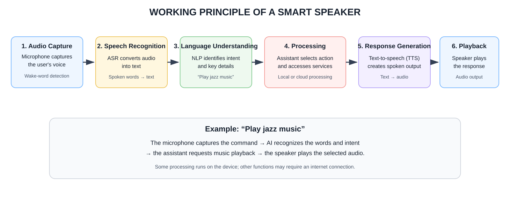

# Exploration-of-AI-Use-Case-Case-studies-on-smart-speakers

## AIM

To study the application of Artificial Intelligence in smart speakers and understand how AI technologies such as Natural Language Processing (NLP), Speech Recognition, Machine Learning, and Voice Assistant technology are used to provide intelligent services.

## THEORY

Smart speakers are voice-controlled devices that use Artificial Intelligence (AI) to understand spoken commands and respond to users. They combine speech recognition, Natural Language Processing (NLP), machine learning, and voice-assistant software. Examples include Amazon Echo, Google Nest, and Apple HomePod.

Speech Recognition converts spoken words into text. NLP interprets the meaning and intent of the command. Machine learning helps improve recognition and personalize responses. The voice assistant processes the request, accesses the required service, and generates a response using speech synthesis.

## WORKING PRINCIPLE

1. The device detects its wake word or activation signal.
2. It captures the user's spoken command.
3. Speech recognition converts the audio into text.
4. NLP identifies the user's intent and relevant information.
5. The voice assistant processes the request and performs the required action, such as answering a question or playing music.
6. The system generates a response and uses text-to-speech to deliver it through the speaker.

**Flow:** Voice input → Wake-word detection → Speech recognition → NLP and intent processing → Action → Spoken response.

## RESULT

The study demonstrates how AI technologies enable smart speakers to recognize voice commands, understand user intent, and provide responses or perform tasks through voice interaction.
